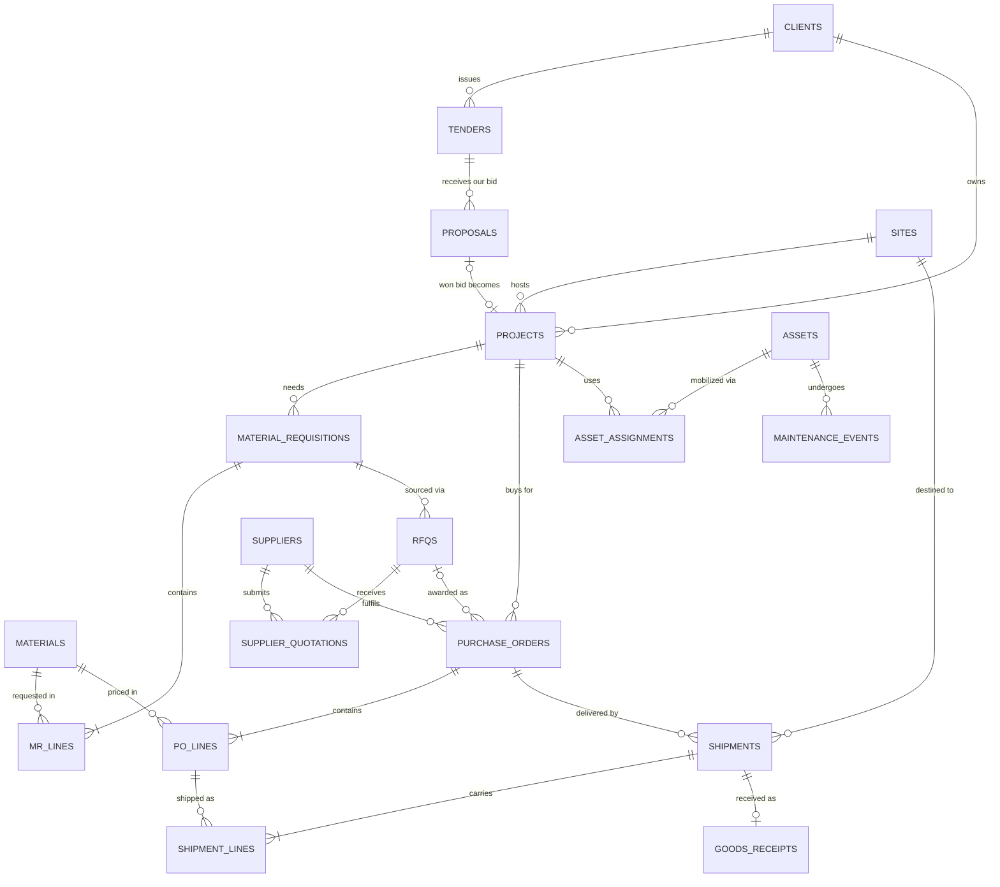

# SupplyScope — ERP Data Model (schema `erp`)

**Phase 1 design document.** The model simulates the operational data of a
Sfax-based EPC contractor in Oil & Gas (GETS-like), grounded in (a) the
company's publicly described activities — strategic sourcing, PO-to-delivery
lifecycle management, logistics coordination, QA/QC, a Sfax fabrication shop,
and field projects in Tunisia and Libya — and (b) the industry-standard EPC
procurement document chain (MR → RFQ → Quotation → PO → Shipment → GRN).

19 tables, 5 clusters. All tables and key columns carry SQL `COMMENT`s: the
agent discovers the schema by introspection, so comments are documentation
*for the LLM*, always in sync with the structure.

---

## 1. Entity-Relationship overview

## 2. Clusters and rationale

### Reference (`clients`, `suppliers`, `materials`, `sites`)
Master data. `suppliers.country` and `sites.country` encode the company's
defining operational reality: a Tunisian fabrication base serving Libyan field
sites → local-vs-import sourcing analyses and cross-border logistics.
`materials.category` mirrors the maintenance disciplines the company itself
lists (piping, steel, electrical, instrumentation, coatings...).

### Tendering (`tenders`, `proposals`)
The commercial upstream: clients issue tenders, the contractor bids.
`proposals.status ∈ {won, lost}` → win-rate KPIs; a won proposal links to the
project it becomes (`projects.proposal_id`).

### Projects (`projects`)
The execution container. Codes mimic the real convention (JI2047, SOR2352).
Every procurement document belongs to a project → all spend is project-attributable.

### Procurement chain (7 tables)
The canonical EPC document flow:
`material_requisitions (+lines)` → `rfqs` → `supplier_quotations` →
`purchase_orders (+lines)` → `shipments (+lines)` → `goods_receipts`.
Dates at each step make *cycle-time* computable per stage. Shipments carry the
customs sub-process (`requires_customs`, entry/clearance dates) and
`freight_cost`. Shipment lines reference PO lines → partial deliveries.

### Assets (`assets`, `asset_assignments`, `maintenance_events`)
Contractor-owned equipment mobilized on projects; assignment periods →
utilization; maintenance events → cost/downtime/reliability.

## 3. KPI coverage map (business question → tables)

| KPI / analysis | Tables involved |
|---|---|
| On-time delivery rate (OTD) by supplier/period | purchase_orders, shipments |
| Supplier lead time: promised vs actual | supplier_quotations, purchase_orders, shipments |
| PO cycle time per stage (MR→RFQ→PO→delivery) | material_requisitions, rfqs, purchase_orders, shipments |
| Spend by project / category / supplier / month | purchase_orders, po_lines, materials, projects |
| Price variance vs catalog; price trend by category | po_lines, materials |
| Supplier concentration (top-N share of spend) | purchase_orders, po_lines, suppliers |
| Customs delay stats by route/period | shipments, sites |
| Freight cost per project / transport mode | shipments, projects |
| Tender win rate by client / project type | tenders, proposals, clients |
| QC rejection rate by supplier | goods_receipts, shipments, purchase_orders |
| Budget consumption: procurement spend vs contract value | projects, purchase_orders, po_lines |
| Asset utilization / maintenance cost & downtime | assets, asset_assignments, maintenance_events |

## 4. Documented simplifications (thesis §limitations)

1. **Quotations at header level** (total + lead time, no per-line prices):
   preserves bid-comparison analytics at a fraction of generator complexity.
2. **No inventory/stock ledger**: materials are received against POs and
   consumed by projects; warehouse stock balances are out of scope v1.
3. **Single-currency amounts per document, no FX conversion table**: cross-
   currency aggregations are performed in questions naturally scoped to one
   currency; an fx_rates table is listed as an extension.
4. **GRN at shipment level** (one GRN per shipment, QC status global):
   line-level QC omitted.
5. **No document revisions/change orders**: each document exists in its final
   state with status history compressed into the current status + dates.

## 5. Integrity & security features

- CHECK constraints on all enumerated statuses, quantities > 0, date ordering.
- `po_lines.line_total` is a **stored generated column** — arithmetic
  consistency guaranteed by the engine.
- `updated_at` maintained by triggers (`erp.touch_updated_at`) — the hook the
  Phase-4 reactivity engine builds on.
- Role `agent_reader`: SELECT-only on `erp`, zero access to `app` — the role
  under which all LLM-generated SQL executes (tested: INSERT/DROP/app access
  all rejected).

## 6. Validation performed (PostgreSQL 16)

- 19/19 tables created from a cold init replay (01 + 02 scripts).
- 19/19 tables carry documentation comments.
- Coherent end-to-end data chain inserted (tender→proposal→project→MR→RFQ→
  quotation→PO→shipment(+customs)→GRN); computed values verified.
- Constraint battery: negative quantity, invalid enum → correctly rejected.
- `updated_at` trigger verified.
- `agent_reader` privilege battery: read OK, write/DDL/app-schema denied.
