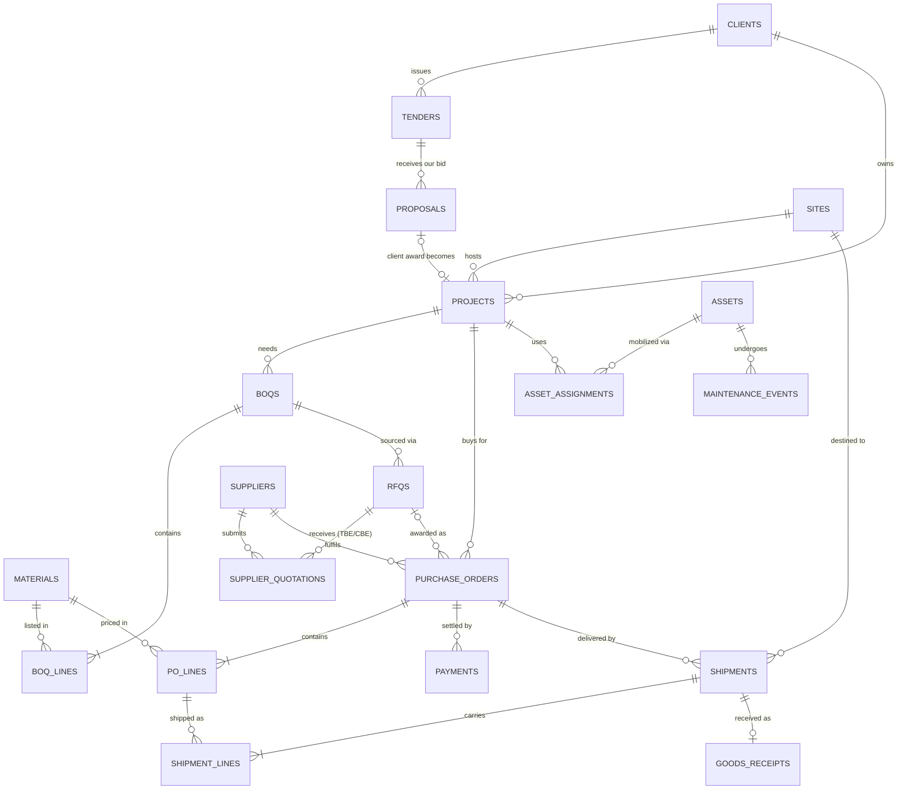

# SupplyScope — ERP Data Model v2 (schema `erp`)

**Phase 1 design document — revision 2.**

The model simulates the operational data of a Sfax-based EPC contractor in
Oil & Gas (GETS-like). **v1** was grounded in public company information and
the industry-standard EPC procurement chain. **v2 refines it after interviews
with two members of GETS's IT team**, who described the real workflow:
three collaborating departments (Tendering, Engineering, Supply Chain, plus
Finance at payment stage), variable contract scope (any combination of
Engineering / Procurement / Construction), the BoQ vocabulary, the TBE/CBE
bid-evaluation stage, supplier payment methods, and Supply Chain's ownership
of the general company asset register (including IT equipment and furniture,
with physical-condition tracking).

20 tables, 5 clusters. All tables and key columns carry SQL `COMMENT`s:
the agent discovers the schema by introspection, so comments are documentation
*for the LLM*, always in sync with the structure.

## 0. Department ownership (encoded in workflow, not as a table)

| Stage | Owner |
|---|---|
| Tenders, proposals, client award | **Tendering** |
| BoQ validation, TBE scores | **Engineering** |
| RFQs ("consultations"), CBE, POs, shipments, receipts, asset register | **Supply Chain** |
| Payment schedule & settlement | **Finance** |

Design decision: no `departments` table — responsibility per stage is
structurally constant (every BoQ is validated by Engineering, every CBE done
by Supply Chain), so normalizing it would add a join that always returns the
same answer. Ownership is documented in table comments instead.

## 1. Entity-Relationship overview

## 2. Clusters and rationale

### Reference (`clients`, `suppliers`, `materials`, `sites`)
Master data. `suppliers.country` and `sites.country` encode the company's
defining operational reality: a Tunisian fabrication base serving Libyan field
sites → local-vs-import sourcing analyses and cross-border logistics.
v2: suppliers carry `preferred_payment_method` (letters of credit typical for
foreign vendors).

### Tendering (`tenders`, `proposals`)
The commercial upstream, owned by the Tendering department — "the ones who
bring projects to the company." v2: tenders request any combination of
**E/P/C scopes** (three boolean flags, ≥1 required) — the business reality
that offers may cover engineering only, procurement only, construction only,
or any pair/all three. `proposals.status='won'` = the **client award**;
its `decision_date` is the award date that triggers the Tendering →
Supply Chain handoff.

### Projects (`projects`)
The execution container (codes mimic JI2047/SOR2352). Carries the same E/P/C
scope flags. Every procurement document belongs to a project.

### Procurement chain (8 tables)
`boqs (+lines)` → `rfqs` → `supplier_quotations` → `purchase_orders (+lines)`
→ `shipments (+lines)` → `goods_receipts`, plus `payments` per PO.
v2 refinements:
- **BoQ** (Bill of Quantities) replaces the generic "material requisition"
  vocabulary; carries `engineering_validated`/`validation_date` — Engineering
  confirms every BoQ before sourcing, even on procurement-only projects.
- **TBE/CBE** on quotations: Technical Bid Evaluation (Engineering; ~70 pass
  threshold) and Commercial Bid Evaluation (Supply Chain). The awarded
  supplier is the best CBE among technically qualified bids — meaning the
  cheapest offer can lose (analytically interesting).
- **payments**: installment schedule and settlement per PO (advance /
  on-delivery / retention), with method and overdue tracking → Finance's
  slice of the workflow.

### Assets & company equipment (`assets`, `asset_assignments`, `maintenance_events`)
v2: the register covers production equipment AND general company equipment
(IT hardware, furniture, tooling), reflecting Supply Chain's real perimeter.
Two orthogonal dimensions: `condition` (physical state: good/fair/damaged/
under_repair/stolen/lost — the "state register" described by the IT team) and
`status` (availability lifecycle).

## 3. KPI coverage map (business question → tables)

| KPI / analysis | Tables involved |
|---|---|
| On-time delivery rate (OTD) by supplier/period | purchase_orders, shipments |
| Supplier lead time: promised vs actual | supplier_quotations, purchase_orders, shipments |
| Cycle time per stage (BoQ→RFQ→PO→delivery) | boqs, rfqs, purchase_orders, shipments |
| Engineering validation delay on BoQs | boqs |
| TBE/CBE score distributions; % lowest-bid-not-awarded | supplier_quotations |
| Spend by project / category / supplier / month | purchase_orders, po_lines, materials, projects |
| Price variance vs catalog; price trend by category | po_lines, materials |
| Supplier concentration (top-N share of spend) | purchase_orders, po_lines, suppliers |
| Outstanding payables, overdue payments, aging by supplier | payments, purchase_orders, suppliers |
| Payment method distribution (e.g. LC share for imports) | payments, suppliers |
| Customs delay stats by route/period | shipments, sites |
| Freight cost per project / transport mode | shipments, projects |
| Tender win rate by client / scope combination | tenders, proposals, clients |
| Business mix: procurement-only vs full-EPC revenue | projects |
| QC rejection rate by supplier | goods_receipts, shipments, purchase_orders |
| Budget consumption: spend vs contract value | projects, purchase_orders, po_lines |
| Asset utilization / maintenance cost & downtime | assets, asset_assignments, maintenance_events |
| Asset condition register (damaged/stolen/lost counts & value) | assets |

## 4. Documented simplifications (thesis §limitations)

1. **Quotations at header level** (total + lead time + scores, no per-line
   prices): preserves bid-comparison analytics at a fraction of complexity.
2. **No inventory/stock ledger**: materials are received against POs and
   consumed by projects; warehouse stock balances are out of scope v1.
3. **Single-currency amounts per document, no FX conversion table.**
4. **GRN at shipment level** (one GRN per shipment, QC status global).
5. **No document revisions/change orders**: current status + dates only.
6. **TBE/CBE as aggregate scores** (0–100), not itemized evaluation grids.
7. **Department ownership by convention** (comments), not a departments table.

## 5. Integrity & security features

- CHECK constraints: enumerated statuses, quantities > 0, date ordering,
  ≥1 contract scope, validated-BoQ⇒validation_date, paid⇒paid_date,
  TBE/CBE ∈ [0,100].
- `po_lines.line_total` is a stored generated column.
- `updated_at` maintained by triggers — the hook for Phase-4 reactivity.
- Role `agent_reader`: SELECT-only on `erp`, zero access to `app`.

## 6. Validation performed (PostgreSQL 16, cold init replay)

- 20/20 tables created; 20/20 carry documentation comments.
- End-to-end v2 chain inserted: procurement-only tender → client award →
  project → Engineering-validated BoQ → RFQ → two quotations where the
  cheaper bid is TBE-disqualified → PO to the qualified supplier →
  2-installment payment (one overdue) → assets incl. IT equipment.
- Constraint battery: no-scope tender, validated-BoQ-without-date,
  out-of-range TBE score, paid-without-date → all correctly rejected.
- `agent_reader` privilege battery re-passed (read OK, writes denied).

---

## v2.1 addendum — FX dimension (`erp.fx_rates`)

Motivated by a live agent failure: the question *"which projects have
procurement spend exceeding their contract value?"* is unanswerable without
currency conversion (contracts in USD/EUR, purchase orders in supplier
currencies), and the agent's defensive workaround silently excluded exactly
the multi-currency projects the question targets. `erp.fx_rates` provides
indicative average rates to TND (`amount * rate_to_tnd`); the generator
populates it with the same rates used internally for budget coherence, and
the validation suite now performs its TND normalization through this table —
i.e. through the same path the agent uses. Simplification #3 (no FX table)
is superseded; rates remain period-average constants rather than a daily
series (documented).
